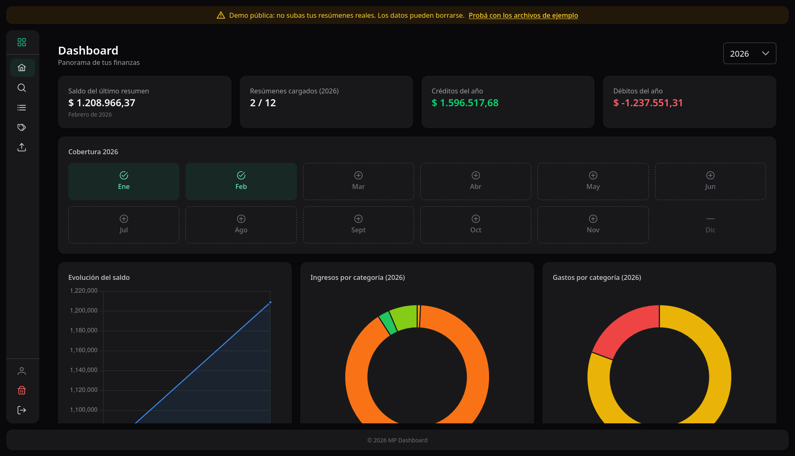
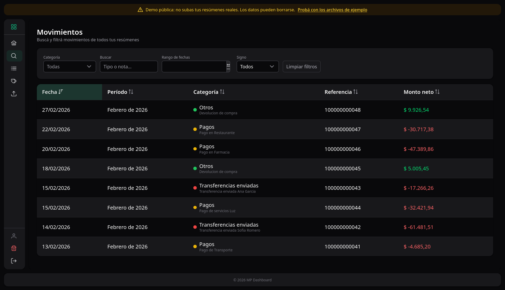
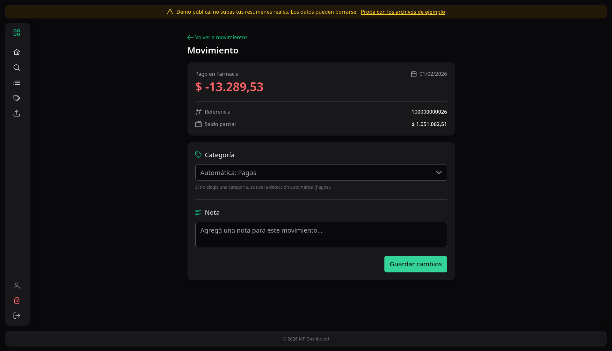

# MP Dashboard

Personal finance dashboard for Mercado Pago account statements. Upload the monthly CSV export and get charts, categories and search across all your movements.

The UI is in Spanish (Argentina). This project is not affiliated with Mercado Pago.

**Live demo:** https://mp-dash-90ac2.web.app. Sign up and try it with the sample statements on the upload page. Don't upload real data.



| Movements                               | Movement detail                              |
| --------------------------------------- | -------------------------------------------- |
|  |  |

## Features

- Sign in with email/password or Google (Firebase Auth).
- Upload monthly statement CSVs. Uploading a month that already exists asks before replacing it.
- Dashboard with the latest balance, the selected year's credits and debits compared to the previous year, and charts by category and month.
- Per-statement analysis (credits, debits and final balance compared with the previous uploaded statement) and transaction list, with notes on each movement.
- Custom categories, plus rules that categorize new movements by transaction type.
- Search movements across all statements.
- Delete your account and all its data.
- Each user's data is isolated by Firestore security rules, and each Firebase project decides who can use the app.
- Demo mode with warnings and sample statements, for the public deployment.

## Tech stack

Angular 20, PrimeNG, Tailwind CSS 4, Chart.js, Firebase (Auth, Firestore, Hosting and App Check), Docker and nginx.

## Requirements

- Docker with Docker Compose.
- A Firebase project with Firestore and Authentication (Email/Password and Google providers) enabled.

## Getting started

1. In the Firebase console, add a web app and copy its config.
2. Create your `.env` and fill in the `FIREBASE_*` values:

   ```bash
   cp .env.example .env
   ```

3. Publish the security rules: paste [`firestore.rules`](firestore.rules) into Firestore > Rules in the console, or run `firebase deploy --only firestore:rules`.
4. Start the dev server and open http://localhost:4200:

   ```bash
   docker compose up
   ```

5. Sign up, then decide who can use the app by creating one of these documents in Firestore from the console. Until then, every request is denied.
   - `allowedUsers/{uid}` (any content): only the listed users. Your UID is in Authentication > Users.
   - `config/access` with the boolean field `open: true`: anyone who signs in.

The container generates `src/environments/environment.ts` from `.env` on startup. Both files are git-ignored.

### Environment variables

| Variable             | Description                                                      |
| -------------------- | ---------------------------------------------------------------- |
| `FIREBASE_*`         | Web app config from the Firebase console (required)              |
| `DEMO_MODE`          | `true` shows the demo warnings and sample files. Default `false` |
| `APP_CHECK_SITE_KEY` | Optional reCAPTCHA site key to enable Firebase App Check         |

## Scripts

Run them inside the container, for example `docker compose exec web npm run lint`.

| Script           | Description                                         |
| ---------------- | --------------------------------------------------- |
| `npm run build`  | Production build                                    |
| `npm test`       | Unit tests (Karma, needs Chrome or `CHROME_BIN`)    |
| `npm run lint`   | ESLint                                              |
| `npm run format` | Format with Prettier (`format:check` only verifies) |

The Firestore rules have their own tests against the emulator (needs Node and Java 21):

```bash
cd tests/firestore-rules && npm ci && npm test
```

CI runs format check, lint, unit tests, rules tests, build and a Docker build on every push and pull request.

## Deploying the demo

The public demo runs on Firebase Hosting, in a separate Firebase project from personal use.

1. Create `.env.demo` with the demo project's config, `DEMO_MODE=true` and, optionally, `APP_CHECK_SITE_KEY`.
2. In the demo project's Firestore, create `config/access` with `open: true`.
3. Build and deploy Hosting and the Firestore rules, all inside Docker:

   ```bash
   ./scripts/deploy-demo.sh
   ```

   The first run asks you to sign in to Firebase. The login is kept in the `mp-dash-firebase-cli` Docker volume.

For App Check, create a score-based reCAPTCHA key (Google Cloud Fraud Defense, formerly reCAPTCHA Enterprise) for the Hosting domains, add its site key in Firebase > App Check and in `.env.demo`, and redeploy. Turn on enforcement once the metrics show only verified requests.

## Production image

The `prod` stage builds the app and serves it with nginx on port 80, with SPA routing and security headers (CSP included):

```bash
set -a; . ./.env; set +a
docker build --target prod \
  --build-arg FIREBASE_API_KEY --build-arg FIREBASE_AUTH_DOMAIN \
  --build-arg FIREBASE_PROJECT_ID --build-arg FIREBASE_STORAGE_BUCKET \
  --build-arg FIREBASE_MESSAGING_SENDER_ID --build-arg FIREBASE_APP_ID \
  -t mp-dash .
docker run -p 8080:80 mp-dash
```

`DEMO_MODE` and `APP_CHECK_SITE_KEY` can be passed as build args too.

Notes:

- The Firebase web config ends up in the bundle; that's expected. Restrict the API key by HTTP referrer in Google Cloud.
- The CSP is defined in both [`nginx/default.conf`](nginx/default.conf) and [`firebase.json`](firebase.json). CI checks that they match.
- If you use a custom `authDomain`, add it to `frame-src` in both files.

## CSV format

The app reads Mercado Pago's account statement export: semicolon-separated, Argentine number format and `DD-MM-YYYY` dates.

```text
INITIAL_BALANCE;CREDITS;DEBITS;FINAL_BALANCE
1.000.000,00;505.000,50;-20.000,00;1.485.000,50

RELEASE_DATE;TRANSACTION_TYPE;REFERENCE_ID;TRANSACTION_NET_AMOUNT;PARTIAL_BALANCE
01-03-2026;Rendimientos;100000000001;5.000,50;1.005.000,50
05-03-2026;Transferencia enviada Ana Garcia;100000000002;-20.000,00;985.000,50
```

## Limitations

- Only the Mercado Pago account statement CSV is supported.
- Up to 3000 movements and 500 KB per statement, since each statement is stored as a single Firestore document (1 MiB max).
- Amounts are shown in ARS.
- Some dependency advisories remain until the move to Angular 21. They're in Firebase's server-side gRPC code and in Angular's build tooling, so they aren't part of the browser bundle.

## License

[MIT](LICENSE)
